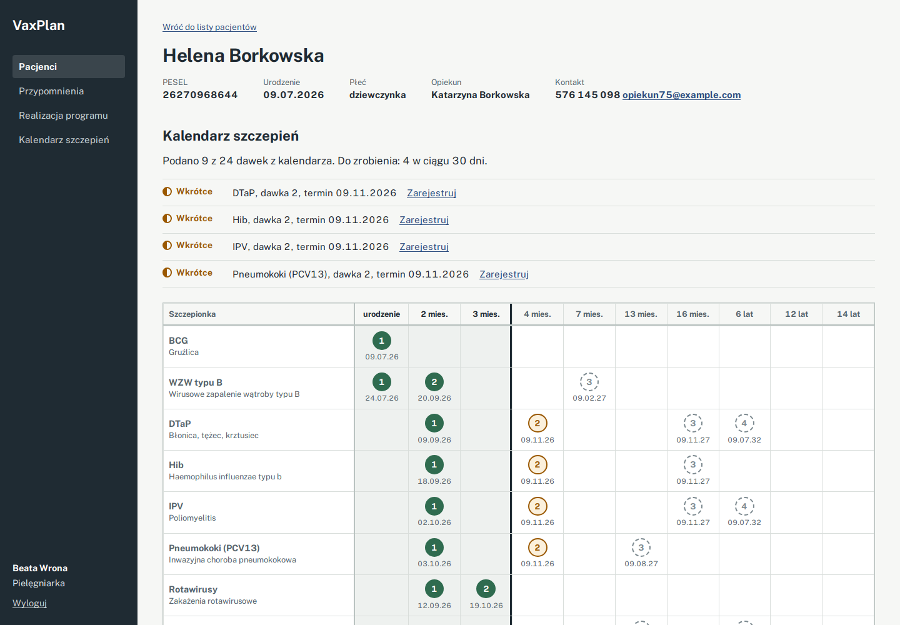
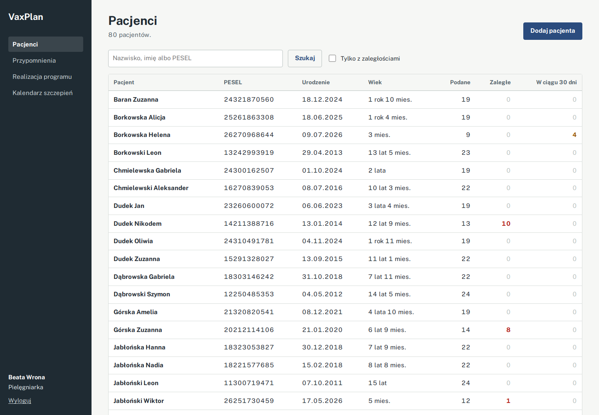
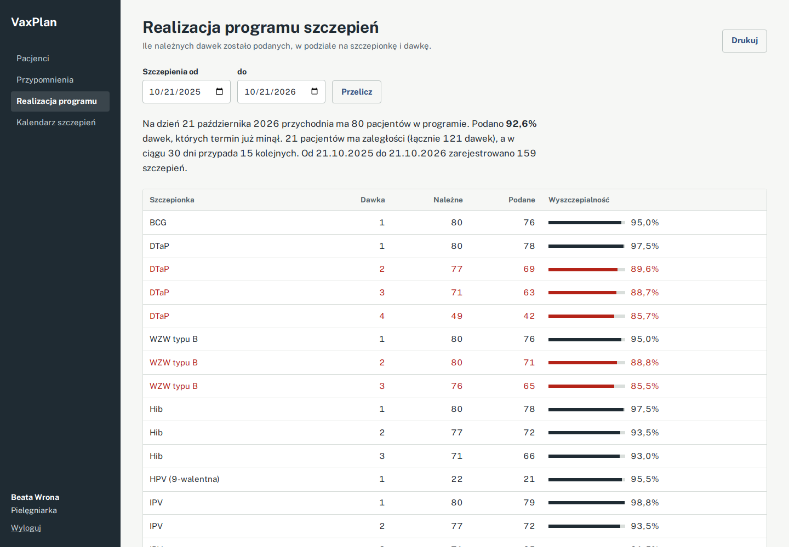
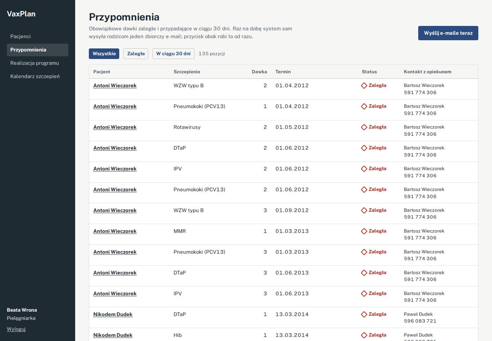
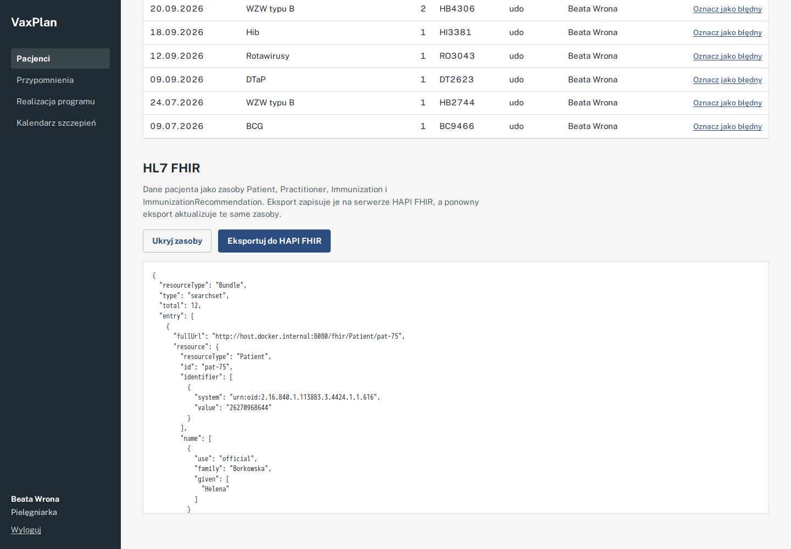
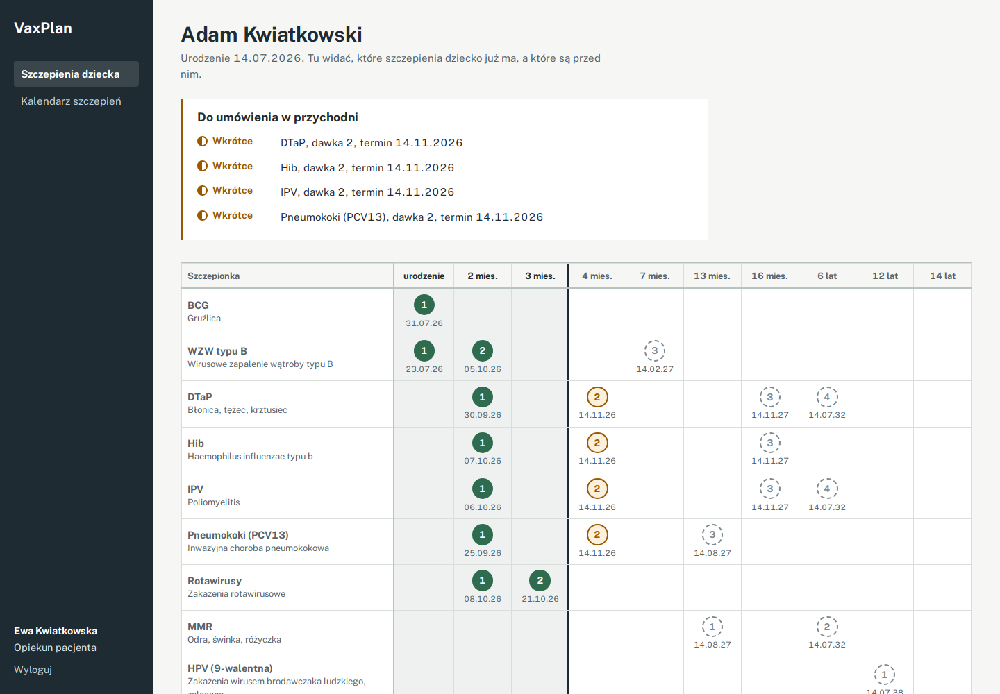
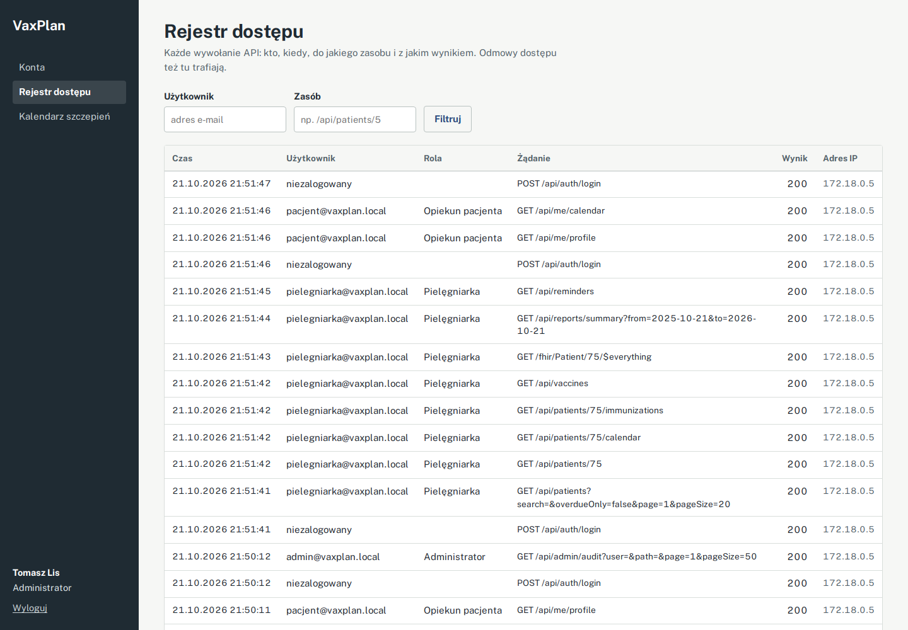
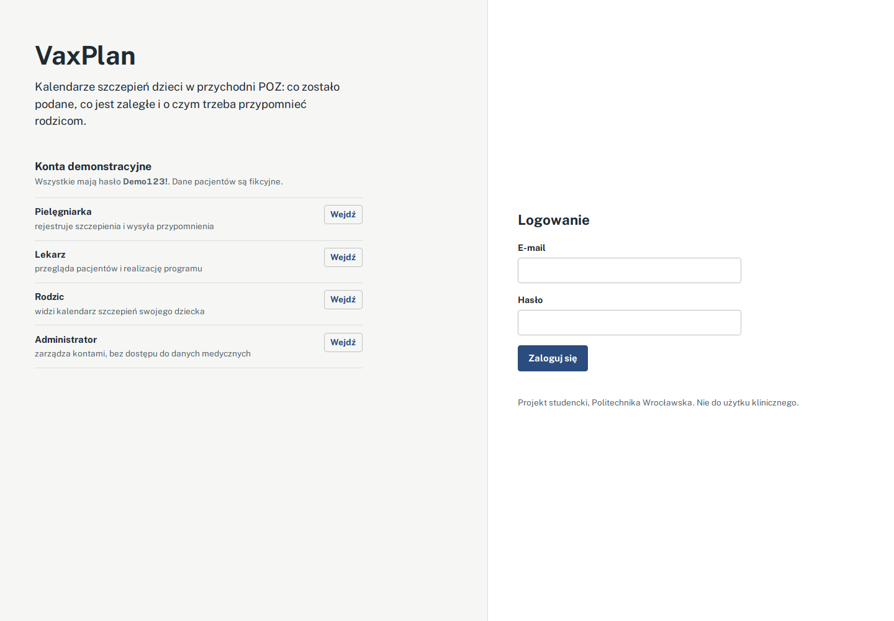

<div align="center">

# Vaccination Programme Planner

**VaxPlan: a vaccination programme planner for a primary care clinic, with schedules, reminders, coverage reports and HL7 FHIR export.**

<p>
  
  
  
  
  
  
  
  
  
  
</p>

<p>
  <a href="#about">About</a> |
  <a href="#whats-inside">What's inside</a> |
  <a href="#screenshots">Screenshots</a> |
  <a href="#quick-start">Quick start</a> |
  <a href="#api">API</a> |
  <a href="#hl7-fhir">HL7 FHIR</a> |
  <a href="#tech">Tech</a>
</p>



</div>

## About

> **A note on names:** the app is called **VaxPlan**. That is the name in the interface, in the code (`VaxPlan.Api`, `VaxPlan.Tests`) and in Docker. The repository is named `vaccination-programme-planner` so the name says what is inside.

VaxPlan is my semester project for *Medical Information Systems Design* (Projektowanie systemów informatyki medycznej) at Wroclaw University of Science and Technology, 2026/27. It is built around one everyday job in a Polish primary care clinic: keeping every child on track with the vaccination schedule.

For each patient the system works out which doses are given, overdue, due soon or planned, lets the nurse record a vaccination, reminds parents about upcoming doses and shows the clinic how well the programme is going. Patient data can be read and exported in the **HL7 FHIR R4** standard, and the whole system starts with one `docker compose up`.

The user interface is in Polish. All patient data is synthetic, and the schedule is a simplified version of the Polish immunisation programme, so the app is **not meant for clinical use**.

## What's inside

| Role | What they can do |
| --- | --- |
| Nurse | Creates patient records (PESEL is validated, birth date and sex are read from it), records vaccinations with dose, lot number and site, marks wrong entries, sends reminders, exports to FHIR. |
| Doctor | Browses patients, schedules, vaccination history, reminders and coverage reports. |
| Patient (parent) | Sees only their own child's schedule and reminders. |
| Administrator | Manages accounts and roles and reads the access log. Has **no access** to medical data. |

## Details worth knowing

- **Schedule grid.** The patient screen lays the schedule out like the printed immunisation programme: vaccines in rows, ages in columns. Columns the child has already reached are shaded, so a missed dose stands out before you read a single date. A nurse can click any missing dose to record it.
- **Live statuses.** Due dates come from the birth date and the age in the schedule. Statuses (given, overdue, due within 30 days, planned) are calculated on every request, so they are never out of date.
- **Business rules.** The same dose cannot be recorded twice, a dose cannot skip the previous one, and the date cannot be in the future or before birth. Every rule is covered by a unit test.
- **Nothing is deleted.** A wrong vaccination is marked `entered-in-error`, the same way FHIR does it, and the dose shows up as missing again.
- **Reminders.** A background job runs once a day and sends one e-mail per family with all overdue and upcoming doses. In the demo the e-mails go to the API log.
- **Access log.** Every API and FHIR call is saved with the user, role, resource, result and IP address, including refused attempts (401/403).
- **Least privilege.** The patient account reads its record ID from the token, not from the URL, so it cannot open someone else's data. The administrator manages users but cannot see medical records.
- **Realistic demo data.** On first start the database is filled with 80 synthetic patients with Polish names, valid PESEL numbers and vaccination history, about a quarter of them with gaps.

## Screenshots

| | |
| --- | --- |
|  |  |
| **Patients** with counts of given, overdue and upcoming doses | **Coverage report** per vaccine and dose |
|  |  |
| **Reminders** for overdue and upcoming doses | **FHIR Bundle** generated for a patient |
|  |  |
| **Patient's own view** with reminders | **Access log** for the administrator |

## Quick start

You only need Git and Docker Desktop.

```bash
git clone https://github.com/roposropos/vaccination-programme-planner.git
cd vaccination-programme-planner
docker compose up --build
```

| Service | Address |
| --- | --- |
| Application | http://localhost:8080 |
| Swagger (API docs) | http://localhost:5080/swagger |
| HAPI FHIR server | http://localhost:8090 (takes 1–2 minutes to start) |

### Demo accounts

The password for every account is **`Demo123!`**. The login screen also has one-click buttons for each role.



| Role | E-mail |
| --- | --- |
| Nurse | `pielegniarka@vaxplan.local` |
| Doctor | `lekarz@vaxplan.local` |
| Patient (parent) | `pacjent@vaxplan.local` |
| Administrator | `admin@vaxplan.local` |

### Running without Docker

Needs the .NET 10 SDK, Node.js 22 and a PostgreSQL database (for example `docker compose up db hapi`).

```bash
dotnet run --project src/VaxPlan.Api   # API on http://localhost:5080

cd web
npm install
npm start                              # frontend on http://localhost:4200
```

### Tests

```bash
dotnet test
```

## API

| Method | Endpoint | Who |
| --- | --- | --- |
| `POST` | `/api/auth/login` | everyone |
| `GET` | `/api/patients?search=&overdueOnly=` | nurse, doctor |
| `POST` | `/api/patients` | nurse |
| `GET` | `/api/patients/{id}/calendar` | nurse, doctor |
| `GET` `POST` | `/api/patients/{id}/immunizations` | read: staff, write: nurse |
| `POST` | `/api/immunizations/{id}/entered-in-error` | nurse |
| `GET` | `/api/me/calendar` | patient (own data only) |
| `GET` `POST` | `/api/reminders`, `/api/reminders/send` | staff, nurse |
| `GET` | `/api/reports/summary?from=&to=` | nurse, doctor |
| `GET` | `/api/vaccines` | signed-in users |
| `GET` `POST` | `/api/admin/users`, `/api/admin/audit` | administrator |
| `GET` | `/fhir/Patient/{id}`, `/fhir/Patient/{id}/$everything` | nurse, doctor |
| `GET` | `/fhir/Immunization?patient={id}`, `/fhir/ImmunizationRecommendation?patient={id}` | nurse, doctor |
| `POST` | `/api/fhir/export/{patientId}` | nurse, doctor |

Errors are returned as ProblemDetails (RFC 7807). The full documentation is in Swagger, where the *Authorize* button accepts the token from the login call.

## HL7 FHIR

| Resource | What it carries |
| --- | --- |
| `Patient` | PESEL as identifier (`urn:oid:2.16.840.1.113883.3.4424.1.1.616`), legal guardian as `contact`. |
| `Practitioner` | The nurse who gave the vaccine. |
| `Immunization` | Vaccine coded in CVX, reason in ICD-10 (Z23–Z27), lot number, site, dose number in the series. |
| `ImmunizationRecommendation` | The plan: `overdue` and `due` doses with the due date (LOINC `30980-7`), finished vaccines as `complete`. |

Export sends a `transaction` Bundle with `PUT` requests, so exporting the same patient again updates the resources on the server instead of duplicating them. After an export the data can be checked on HAPI, for example `http://localhost:8090/fhir/Immunization?patient=pat-1`.

```json
{
  "resourceType": "Immunization",
  "id": "imm-12",
  "status": "completed",
  "vaccineCode": { "coding": [{ "system": "http://hl7.org/fhir/sid/cvx", "code": "03", "display": "MMR" }] },
  "patient": { "reference": "Patient/pat-1" },
  "occurrenceDateTime": "2025-03-02",
  "lotNumber": "MM4821",
  "reasonCode": [{ "coding": [{ "system": "http://hl7.org/fhir/sid/icd-10", "code": "Z27.4" }] }],
  "protocolApplied": [{ "doseNumberPositiveInt": 1, "seriesDosesPositiveInt": 2 }]
}
```

## Project structure

```text
vaccination-programme-planner/
|-- src/VaxPlan.Api/
|   |-- Domain/            # entities, roles, PESEL validation
|   |-- Data/              # EF Core DbContext, vaccine schedule, synthetic data seeder
|   |-- Services/          # schedule calculation, vaccination rules, reports, reminders, JWT
|   |-- Fhir/              # FHIR mapping, patient resources, HAPI client
|   |-- Controllers/       # REST API and FHIR endpoints
|   |-- Infrastructure/    # access log middleware, ProblemDetails error handling
|   `-- Program.cs
|-- tests/VaxPlan.Tests/   # xUnit: schedule, rules, reports, PESEL, FHIR
|-- web/                   # Angular frontend served by nginx
|   `-- src/app/
|       |-- core/          # API client, auth, guards, models
|       |-- pages/         # one component per screen
|       `-- shared/        # schedule table used by staff and patients
|-- docs/screenshots/
|-- docker-compose.yml     # PostgreSQL, HAPI FHIR, API, web
`-- .github/workflows/     # CI: build, tests, Docker images
```

## Tech

| Part | Choice |
| --- | --- |
| Backend | C# and ASP.NET Core 10 Web API, Entity Framework Core 10, PostgreSQL 16. |
| Auth | JWT with roles: patient, nurse, doctor, administrator. |
| Frontend | Angular 20 with standalone components and signals, plain CSS. |
| Standards | HL7 FHIR R4, CVX vaccine codes, ICD-10, LOINC, PESEL OID. |
| FHIR server | HAPI FHIR in a container, used as the export target. |
| Tests | xUnit with EF Core InMemory, 37 tests. |
| Running | Docker Compose, GitHub Actions for CI. |

## Design decisions

| Decision | Why |
| --- | --- |
| Statuses calculated, not stored | They depend on today's date, so storing them would make them go stale. For a clinic of a few hundred patients this is fast enough. At larger scale the calculation could move to SQL or a cache. |
| `CalendarService` without a database | It takes the patient, the schedule and the vaccinations and returns the plan, so the core logic is easy to test. |
| FHIR resources built by hand | Built with `System.Text.Json` instead of the Firely SDK, so the structure of every resource is visible in the code. |
| Schema created with `EnsureCreated()` | Keeps the student project easy to run. A production version would use EF Core migrations. |

## Limitations

- The schedule is simplified and only based on the Polish immunisation programme. It does not follow the current official announcement.
- Reminder e-mails are written to the log. The `INotificationSender` interface is the place to plug in SMTP.
- There is no connection to P1 (the national e-health platform and its e-vaccination card), which would need certificates and the official test environment.
- The JWT keys in `appsettings.json` and `docker-compose.yml` are demo values and should be replaced outside local use.

## Author

**Robert Tworek**, Technical Computer Science student at Wroclaw University of Science and Technology.

Released under the [MIT](LICENSE) licence.
